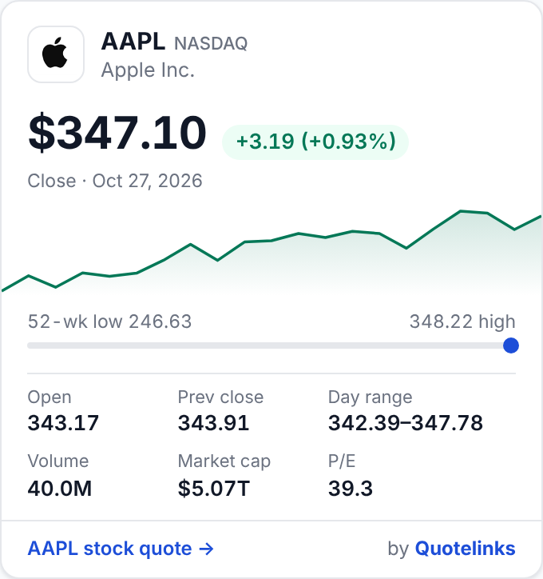
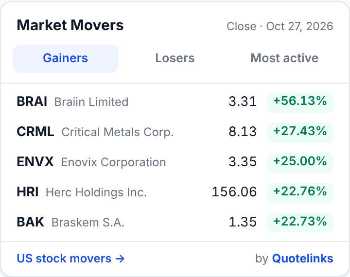
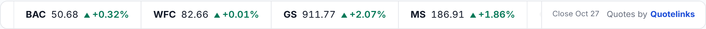

# Quotelinks Stock Widgets

Free, embeddable stock market widgets for any website or blog: a **Stock Card**, a scrolling **Ticker Tape** and a **Market Movers** table. They cover US stocks and ETFs with end-of-day data.

No API key, no sign-up, no build step. Paste two lines of HTML and you're done.

- **Live demos and code generators:** https://www.quotelinks.com/widgets/
- **Data:** [Quotelinks](https://www.quotelinks.com/), with end-of-day quotes for US-listed stocks and ETFs

<p>
  
  
</p>
<p></p>

| Widget | What it shows | Generator |
|---|---|---|
| Stock Card | Price, change, day range, 52-week range, market cap, P/E (or net assets and expense ratio for ETFs), and a sparkline | [stockcard.html](https://www.quotelinks.com/widgets/stockcard.html) |
| Ticker Tape | A scrolling strip of up to 20 symbols with price and % change | [tickertape.html](https://www.quotelinks.com/widgets/tickertape.html) |
| Market Movers | Top gainers, losers and most active, for stocks or ETFs | [movers.html](https://www.quotelinks.com/widgets/movers.html) |

---

## Quick start

### Stock Card

```html
<div class="ql-stockcard" data-symbol="AAPL" data-size="full" data-theme="light">
  <a href="https://www.quotelinks.com/stocks/aapl.html">AAPL stock quote</a> by
  <a href="https://www.quotelinks.com/">Quotelinks</a>
</div>
<script src="https://www.quotelinks.com/widgets/stockcard.js" async></script>
```

| Attribute | Values |
|---|---|
| `data-symbol` | Ticker, e.g. `AAPL`, `SPY`, `BRK.B` (or `BRK-B`). If omitted, it's taken from the first link. |
| `data-size` | `full` (default) or `compact` |
| `data-theme` | `light` (default), `dark` or `auto` (follows the visitor's system setting) |

For an ETF, link to `/etfs/<symbol>.html` instead of `/stocks/<symbol>.html`.

### Ticker Tape

```html
<div class="ql-tickertape" data-symbols="AAPL,MSFT,NVDA,AMZN,SPY,QQQ" data-theme="light">
  Stock quotes by <a href="https://www.quotelinks.com/">Quotelinks</a>
</div>
<script src="https://www.quotelinks.com/widgets/tickertape.js" async></script>
```

| Attribute | Values |
|---|---|
| `data-symbols` | Comma-separated tickers, up to 20. If omitted, it shows the largest US stocks plus SPY and QQQ. |
| `data-size` | `regular` (default: symbol, price, change) or `compact` (symbol, change) |
| `data-theme` | `light` (default), `dark` or `auto` |
| `data-style` | `boxed` (rounded border, for use inside a page). If omitted, it's a full-width strip. |
| `data-speed` | `slow`, `normal` (default), `fast` or `still` (no scrolling; swipe to see more) |

### Market Movers

```html
<div class="ql-movers" data-market="stocks" data-rows="5" data-theme="light">
  <a href="https://www.quotelinks.com/stocks.html">US stock movers</a> by
  <a href="https://www.quotelinks.com/">Quotelinks</a>
</div>
<script src="https://www.quotelinks.com/widgets/movers.js" async></script>
```

| Attribute | Values |
|---|---|
| `data-market` | `stocks` (default) or `etfs`. For ETFs, link to `https://www.quotelinks.com/etfs.html` ("US ETF movers"). |
| `data-rows` | `5` (default) or `10` |
| `data-tab` | `gainers` (default), `losers` or `active`: the list shown first |
| `data-size` | `compact` (no company names), or omit |
| `data-theme` | `light` (default), `dark` or `auto` |

The lists cover US stocks with a price of at least $1 and a market cap of at least $300M, and ETFs with net assets of at least $100M. Leveraged and inverse ETFs are left out of gainers and losers.

---

## Features

- **Lightweight:** each script is about 5 KB gzipped, has no dependencies, and makes one JSON request per widget.
- **Isolated styling:** rendering happens inside a Shadow DOM, so your CSS and the widget's CSS never clash.
- **Light, dark and auto themes**, and responsive layouts that work from about 240–300 px wide.
- **Accessible:** keyboard-navigable tabs, the ticker pauses on hover or focus, and it respects "reduce motion".
- **Several widgets per page:** load each script once and add as many `<div>`s as you like. Widgets added later by page builders are picked up automatically, or you can call `qlStockcard.scan()`, `qlTickertape.scan()` or `qlMovers.scan()`.
- **Stable embed contract:** script URLs and attributes are never renamed or removed, so an embed keeps working indefinitely.

## Platforms

These work anywhere you can paste HTML:

- **WordPress:** use a *Custom HTML* block.
- **Blogger:** use an *HTML/JavaScript* gadget.
- **Wix / Squarespace / Webflow:** use an *Embed code* element.
- **Ghost:** use an *HTML* card.
- Plain HTML, React (via `dangerouslySetInnerHTML` or an effect that appends the script), Vue, Hugo, Jekyll and similar.

## Examples

The [`examples/`](examples/) folder has ready-to-open HTML pages:

- [`examples/index.html`](examples/index.html): all three widgets on one page
- [`examples/dark-theme.html`](examples/dark-theme.html): dark theme on a dark page
- [`examples/blog-sidebar.html`](examples/blog-sidebar.html): a typical blog layout with a sidebar card and a movers table

Open any of them straight from disk; no server is needed.

## Source

[`src/`](src/) contains readable copies of the widget scripts, for review and transparency. Always embed the hosted versions from `https://www.quotelinks.com/widgets/`, because those receive fixes and keep working with the data API.

## Data and terms

- Quotes are **end-of-day** (the last close), not real-time, and are refreshed after each US trading session.
- They are provided for information only and are **not investment advice**.
- Please keep the credit links inside each `<div>`. They are shown in the widget footer, and if a symbol is missing, the widget uses them to work out which one to show.

## License

The code in this repository is released under the [MIT License](LICENSE). Market data served by quotelinks.com is not covered by this license.

---

Made by [Quotelinks](https://www.quotelinks.com/), which offers free stock quotes, a [stock screener](https://www.quotelinks.com/stockmarketscreener.html) and charts for US stocks and ETFs.
